# 🌸 Colección de Diagramas Entidad-Relación (E-R) ✨

¡Bienvenid@ a mi repositorio de **Bases de Datos**! 💖 Aquí encontrarás una colección organizada de diseños conceptuales y diagramas Entidad-Relación (E-R) desarrollados para diversos escenarios académicos y prácticos[cite: 1].

---

## 📌 Datos de la Estudiante

| Campo | Detalles |
| :--- | :--- |
| **Estudiante** | Noelia Bustan |
| **Institución** | Universidad Nacional de Loja |
| **Facultad** | Energía, las Industrias y los Recursos Naturales No Renovables |
| **Carrera** | Computación |
| **Materia** | Base de Datos |
| **Docente** | Ing. René Guamán |
| **Periodo Académico** | 2026 - 2027 |

---

<div align="center">

# 📚 PORTAFOLIO DE BASES DE DATOS

### Colección de Diagramas Entidad-Relación

**9 ejercicios prácticos de modelado de bases de datos**

---

*Diseño conceptual · Diagramas E-R · Modelo relacional · SQL*

</div>

## 📑 Índice de ejercicios

| N.º | Ejercicio | Categoría |
|:---:|:---|:---|
| 01 | [Sistema de Biblioteca](#ejercicio-1-sistema-de-biblioteca) | Ejemplo guiado |
| 02 | [Pedidos de Restaurante](#ejercicio-2-pedidos-de-restaurante) | Ejemplo guiado |
| 03 | [Clínica Médica](#ejercicio-3-clínica-médica) | Ejemplo guiado |
| 04 | [Sistema de Aerolínea](#ejercicio-4-sistema-de-aerolínea) | Ejemplo guiado |
| 05 | [Empresa Discográfica](#ejercicio-5-empresa-discográfica) | Ejercicio propuesto |
| 06 | [Tienda Informática](#ejercicio-6-tienda-informática) | Ejercicio propuesto |
| 07 | [Discos Musicales](#ejercicio-7-discos-musicales) | Ejercicio propuesto |
| 08 | [Camiones](#ejercicio-8-camiones) | Ejercicio propuesto |
| 09 | [Veterinaria](#ejercicio-9-veterinaria) | Ejercicio propuesto |

---

# 01 · EJEMPLOS GUIADOS

## Ejercicio 1: Sistema de Biblioteca

**Descripción**

Una biblioteca registra libros y autores. Un libro puede tener varios autores y un autor varios libros. Los socios toman libros prestados; de cada préstamo interesan la fecha de retiro y la de devolución.

<details>
<summary><b>📐 Diagrama Entidad-Relación</b></summary>

<br>

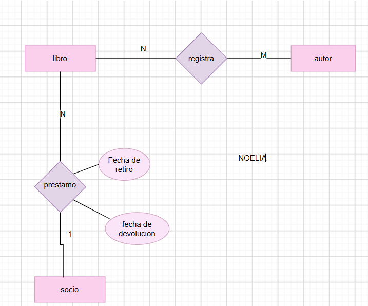

</details>

<details>
<summary><b>📊 Tablas</b></summary>

<br>

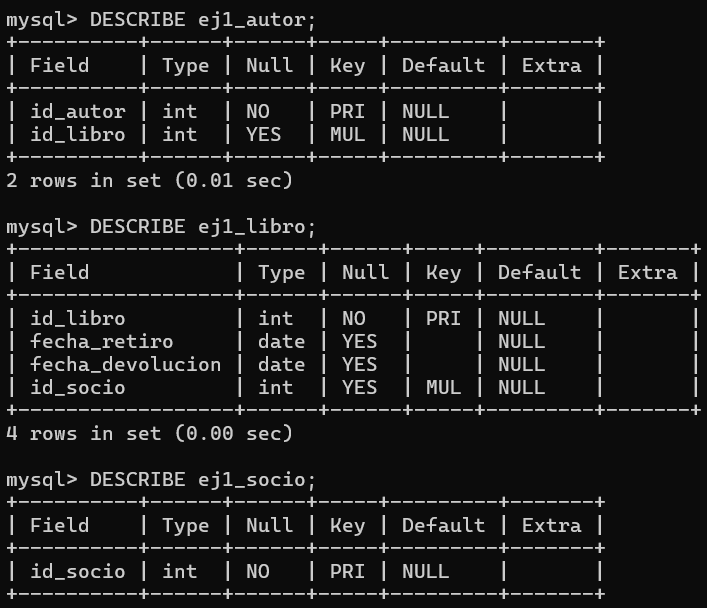

</details>

<details>
<summary><b>💻 Código SQL</b></summary>

<br>

```sql
USE ejercicios_BD;

CREATE TABLE ej1_autor (
    id_autor INT PRIMARY KEY,
    nombre VARCHAR(30) NOT NULL
);

CREATE TABLE ej1_libro (
    codigo INT PRIMARY KEY,
    titulo VARCHAR(100) NOT NULL,
    editorial VARCHAR(50),
    precio DECIMAL(10,2)
);

CREATE TABLE ej1_escribe (
    id_autor INT NOT NULL,
    codigo INT NOT NULL,
    PRIMARY KEY (id_autor, codigo),
    FOREIGN KEY (id_autor) REFERENCES ej1_autor(id_autor),
    FOREIGN KEY (codigo) REFERENCES ej1_libro(codigo)
);

CREATE TABLE ej1_ejemplar (
    n_copia INT NOT NULL,
    codigo INT NOT NULL,
    estado VARCHAR(30),
    PRIMARY KEY (n_copia, codigo),
    FOREIGN KEY (codigo) REFERENCES ej1_libro(codigo)
);

CREATE TABLE ej1_lector (
    dni VARCHAR(10) PRIMARY KEY,
    nombre VARCHAR(30) NOT NULL,
    direccion VARCHAR(100),
    telefono VARCHAR(15)
);

CREATE TABLE ej1_prestamo (
    dni VARCHAR(10) NOT NULL,
    codigo INT NOT NULL,
    n_copia INT NOT NULL,
    PRIMARY KEY (dni, codigo, n_copia),
    FOREIGN KEY (dni) REFERENCES ej1_lector(dni),
    FOREIGN KEY (codigo, n_copia)
        REFERENCES ej1_ejemplar(codigo, n_copia)
);
```


</details>

---

## Ejercicio 2: Pedidos de Restaurante

**Descripción**

Los clientes realizan pedidos que contienen varios platos con distinta cantidad. Los platos se agrupan en categorías. Cada pedido lo atiende un único mesero. El precio del plato debe registrarse tal como estaba al momento del pedido, aunque luego cambie.

<details>
<summary><b>📐 Diagrama Entidad-Relación</b></summary>

<br>

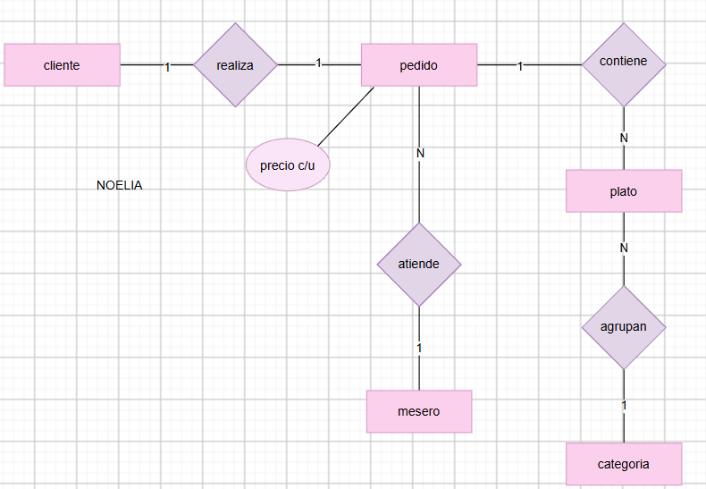

</details>

<details>
<summary><b>📊 Tablas</b></summary>

<br>

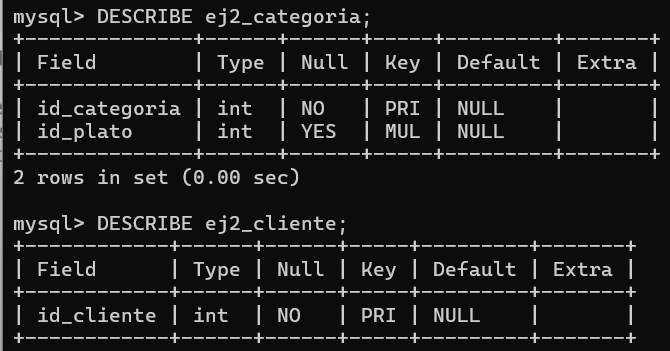

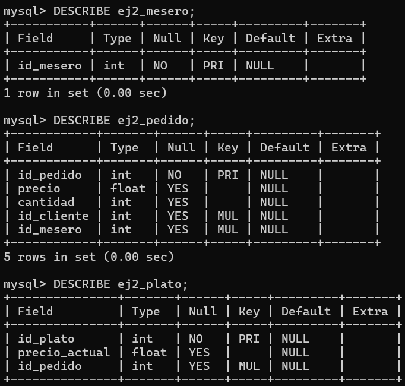

</details>

<details>
<summary><b>💻 Código SQL</b></summary>

<br>


```sql
USE ejercicios_BD;

CREATE TABLE ej2_aeropuerto (
    codigo INT PRIMARY KEY,
    nombre VARCHAR(50) NOT NULL,
    pais   VARCHAR(30) NOT NULL,
    ciudad VARCHAR(30) NOT NULL
);

CREATE TABLE ej2_vuelo (
    numero_vuelo      INT PRIMARY KEY,
    hora              TIME NOT NULL,
    origen            VARCHAR(30) NOT NULL,
    destino           VARCHAR(30) NOT NULL,
    aeropuerto_origen INT NOT NULL,
    aeropuerto_destino INT NOT NULL,
    FOREIGN KEY (aeropuerto_origen)  REFERENCES ej2_aeropuerto(codigo),
    FOREIGN KEY (aeropuerto_destino) REFERENCES ej2_aeropuerto(codigo)
);

CREATE TABLE ej2_avion (
    numero_avion INT PRIMARY KEY,
    tipo         VARCHAR(30) NOT NULL,
    base         VARCHAR(30) NOT NULL
);

CREATE TABLE ej2_programa (
    codigo_programa INT PRIMARY KEY,
    tipo            VARCHAR(30) NOT NULL
);

CREATE TABLE ej2_asigna (
    numero_vuelo    INT NOT NULL,
    numero_avion    INT NOT NULL,
    codigo_programa INT NOT NULL,
    PRIMARY KEY (numero_vuelo, numero_avion, codigo_programa),
    FOREIGN KEY (numero_vuelo)    REFERENCES ej2_vuelo(numero_vuelo),
    FOREIGN KEY (numero_avion)    REFERENCES ej2_avion(numero_avion),
    FOREIGN KEY (codigo_programa) REFERENCES ej2_programa(codigo_programa)
);

CREATE TABLE ej2_sindicato (
    codigo_sindicato INT PRIMARY KEY,
    nombre           VARCHAR(50) NOT NULL
);

CREATE TABLE ej2_empleado (
    dni              VARCHAR(10) PRIMARY KEY,
    nombre           VARCHAR(30) NOT NULL,
    direccion        VARCHAR(100),
    telefono         VARCHAR(15),
    sueldo           DECIMAL(10,2),
    codigo_sindicato INT NOT NULL,
    FOREIGN KEY (codigo_sindicato) REFERENCES ej2_sindicato(codigo_sindicato)
);

CREATE TABLE ej2_piloto (
    dni         VARCHAR(10) PRIMARY KEY,
    horas_vuelo INT NOT NULL,
    FOREIGN KEY (dni) REFERENCES ej2_empleado(dni)
);

CREATE TABLE ej2_tecnico (
    dni       VARCHAR(10) PRIMARY KEY,
    cargo     VARCHAR(30) NOT NULL,
    FOREIGN KEY (dni) REFERENCES ej2_empleado(dni)
);

CREATE TABLE ej2_trabaja (
    dni          VARCHAR(10) NOT NULL,
    numero_avion INT NOT NULL,
    PRIMARY KEY (dni, numero_avion),
    FOREIGN KEY (dni)          REFERENCES ej2_tecnico(dni),
    FOREIGN KEY (numero_avion) REFERENCES ej2_avion(numero_avion)
);

CREATE TABLE ej2_controla (
    dni          VARCHAR(10) NOT NULL,
    numero_avion INT NOT NULL,
    PRIMARY KEY (dni, numero_avion),
    FOREIGN KEY (dni)          REFERENCES ej2_tecnico(dni),
    FOREIGN KEY (numero_avion) REFERENCES ej2_avion(numero_avion)
);
```

</details>

---

## Ejercicio 3: Clínica Médica

**Descripción**

Los pacientes solicitan citas; cada cita la atiende un médico a un paciente en fecha, hora y consultorio. De algunas citas se genera una receta que incluye medicamentos con dosis y duración. Cada médico pertenece a una especialidad.

<details>
<summary><b>📐 Diagrama Entidad-Relación</b></summary>

<br>

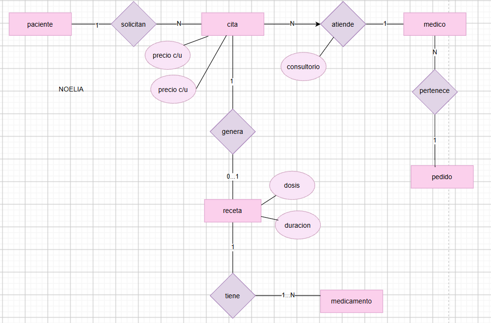

</details>

<details>
<summary><b>📊 Tablas</b></summary>

<br>

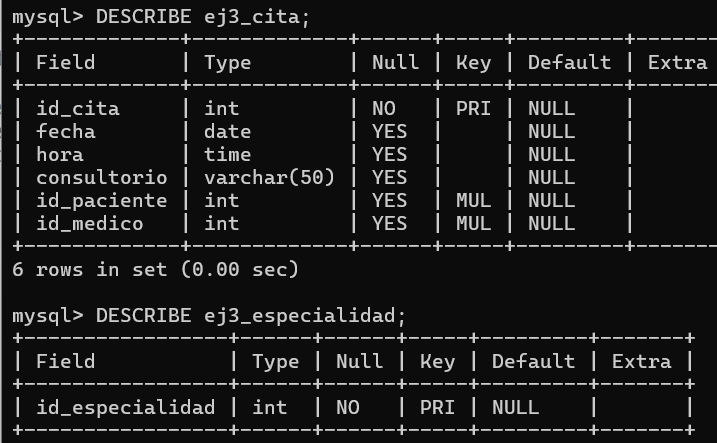

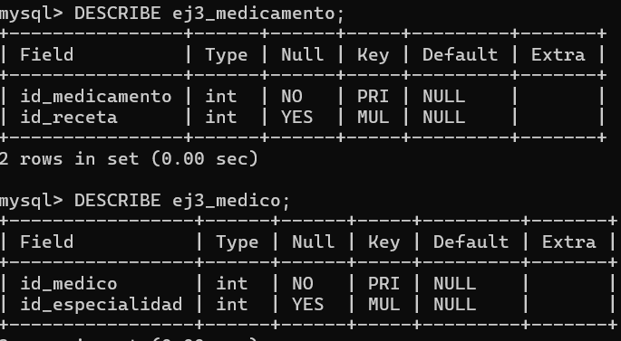

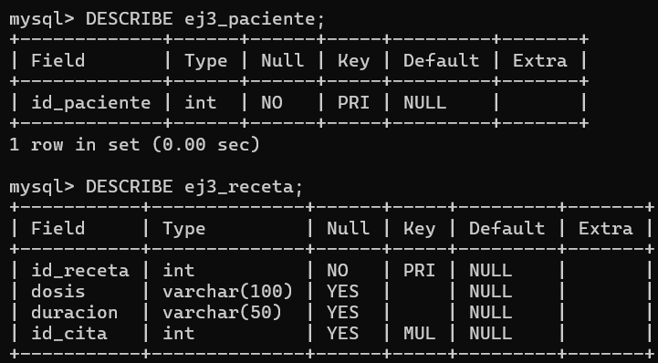

</details>

<details>
<summary><b>💻 Código SQL</b></summary>

<br>


```sql
USE ejercicios_BD;

CREATE TABLE ej3_sucursal (
    codigo_sucursal INT PRIMARY KEY,
    direccion       VARCHAR(100) NOT NULL,
    telefono        VARCHAR(15)
);

CREATE TABLE ej3_empleado (
    dni             VARCHAR(10) PRIMARY KEY,
    nombre          VARCHAR(30) NOT NULL,
    apellidos       VARCHAR(40) NOT NULL,
    telefono        VARCHAR(15),
    codigo_sucursal INT NOT NULL,
    FOREIGN KEY (codigo_sucursal) REFERENCES ej3_sucursal(codigo_sucursal)
);

CREATE TABLE ej3_coche (
    matricula       VARCHAR(10) PRIMARY KEY,
    marca           VARCHAR(30) NOT NULL,
    modelo          VARCHAR(30) NOT NULL,
    color           VARCHAR(20),
    precio_hora     DECIMAL(8,2) NOT NULL,
    codigo_sucursal INT NOT NULL,
    FOREIGN KEY (codigo_sucursal) REFERENCES ej3_sucursal(codigo_sucursal)
);

CREATE TABLE ej3_cliente (
    dni       VARCHAR(10) PRIMARY KEY,
    nombre    VARCHAR(30) NOT NULL,
    apellidos VARCHAR(40) NOT NULL,
    direccion VARCHAR(100),
    telefono  VARCHAR(15)
);

CREATE TABLE ej3_cliente_avales (
    dni_cliente VARCHAR(10) NOT NULL,
    dni_aval    VARCHAR(10) NOT NULL,
    PRIMARY KEY (dni_cliente, dni_aval),
    FOREIGN KEY (dni_cliente) REFERENCES ej3_cliente(dni),
    FOREIGN KEY (dni_aval)    REFERENCES ej3_cliente(dni)
);

CREATE TABLE ej3_alquila (
    codigo_alquiler INT PRIMARY KEY,
    fecha_inicio    DATE NOT NULL,
    fecha_fin       DATE NOT NULL,
    precio_total    DECIMAL(10,2),
    dni_cliente     VARCHAR(10) NOT NULL,
    matricula       VARCHAR(10) NOT NULL,
    dni_empleado    VARCHAR(10) NOT NULL,
    FOREIGN KEY (dni_cliente)  REFERENCES ej3_cliente(dni),
    FOREIGN KEY (matricula)    REFERENCES ej3_coche(matricula),
    FOREIGN KEY (dni_empleado) REFERENCES ej3_empleado(dni)
);
```


</details>

---

## Ejercicio 4: Sistema de Aerolínea

**Descripción**

Una aerolínea opera vuelos (cada uno con número, fecha, origen y destino), cada vuelo lo realiza un avión. Los pasajeros realizan reservas para un vuelo específico, indicando asiento y tarifa pagada en el momento de la reserva.

<details>
<summary><b>📐 Diagrama Entidad-Relación</b></summary>

<br>

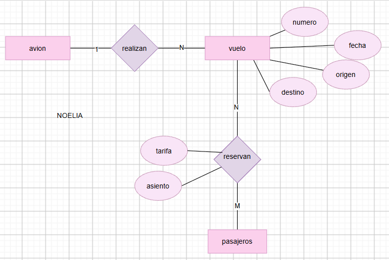

</details>

<details>
<summary><b>📊 Tablas</b></summary>

<br>

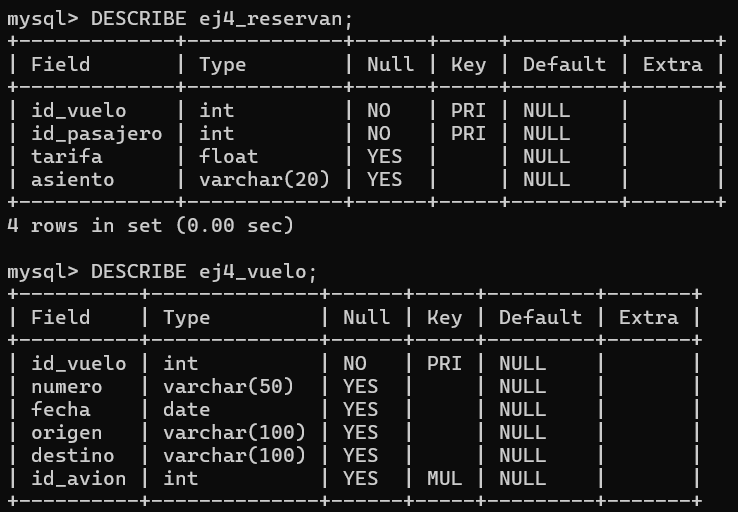

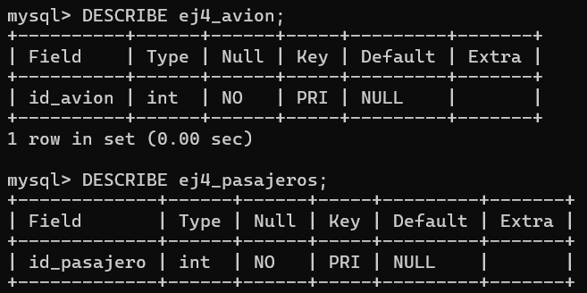

</details>

<details>
<summary><b>💻 Código SQL</b></summary>

<br>


```sql
USE ejercicios_BD;

CREATE TABLE ej4_cientifico (
    dni    VARCHAR(10) PRIMARY KEY,
    nombre VARCHAR(50) NOT NULL
);

CREATE TABLE ej4_proyecto (
    id_proyecto INT PRIMARY KEY,
    nombre      VARCHAR(100) NOT NULL,
    horas       INT NOT NULL
);

CREATE TABLE ej4_asiste (
    dni         VARCHAR(10) NOT NULL,
    id_proyecto INT NOT NULL,
    PRIMARY KEY (dni, id_proyecto),
    FOREIGN KEY (dni)         REFERENCES ej4_cientifico(dni),
    FOREIGN KEY (id_proyecto) REFERENCES ej4_proyecto(id_proyecto)
);

CREATE TABLE ej4_editorial (
    id_editorial INT PRIMARY KEY,
    nombre       VARCHAR(50) NOT NULL
);

CREATE TABLE ej4_libro (
    codigo       INT PRIMARY KEY,
    titulo       VARCHAR(100) NOT NULL,
    id_editorial INT NOT NULL,
    FOREIGN KEY (id_editorial) REFERENCES ej4_editorial(id_editorial)
);

CREATE TABLE ej4_escribe (
    dni    VARCHAR(10) NOT NULL,
    codigo INT NOT NULL,
    PRIMARY KEY (dni, codigo),
    FOREIGN KEY (dni)    REFERENCES ej4_cientifico(dni),
    FOREIGN KEY (codigo) REFERENCES ej4_libro(codigo)
);
```


</details>

---

# 02 · EJERCICIOS PROPUESTOS

## Ejercicio 5: Empresa Discográfica

**Descripción**

Una empresa discográfica necesita modelar los datos sobre sus diferentes recursos según las siguientes características:

- **Manager:** De cada mánager se almacena un identificador y su nombre. Un manager representa a una serie de artistas.
- **Artista:** Un artista es representado por un manager. Se almacena su nombre completo y su NIF.
- **Evento de promoción:** Los artistas participan en eventos de promoción para dar a conocer sus trabajos. En un evento pueden participar varios artistas. Se almacena un identificador único, la fecha de celebración y el número de asistentes.

<details>
<summary><b>📐 Diagrama Entidad-Relación</b></summary>

<br>

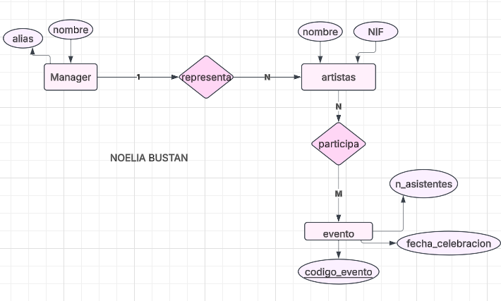

</details>

<details>
<summary><b>📊 Tablas</b></summary>

<br>

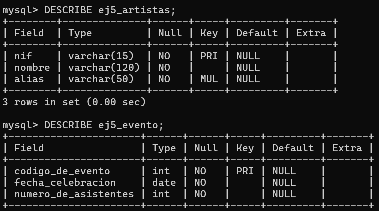

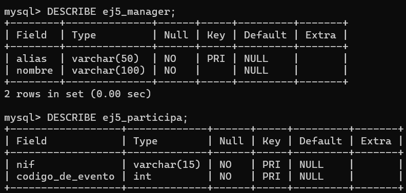

</details>

<details>
<summary><b>💻 Código SQL</b></summary>

<br>


```sql
USE ejercicios_BD;

CREATE TABLE ej5_centro (
    codigo_centro INT PRIMARY KEY,
    nombre        VARCHAR(50) NOT NULL,
    direccion     VARCHAR(100)
);

CREATE TABLE ej5_profesor (
    dni           VARCHAR(10) PRIMARY KEY,
    nombre        VARCHAR(30) NOT NULL,
    apellidos     VARCHAR(40) NOT NULL,
    especialidad  VARCHAR(40) NOT NULL,
    codigo_centro INT NOT NULL,
    FOREIGN KEY (codigo_centro) REFERENCES ej5_centro(codigo_centro)
);

CREATE TABLE ej5_modulo (
    codigo_modulo INT PRIMARY KEY,
    nombre        VARCHAR(50) NOT NULL
);

CREATE TABLE ej5_imparte (
    dni           VARCHAR(10) NOT NULL,
    codigo_modulo INT NOT NULL,
    PRIMARY KEY (dni, codigo_modulo),
    FOREIGN KEY (dni)           REFERENCES ej5_profesor(dni),
    FOREIGN KEY (codigo_modulo) REFERENCES ej5_modulo(codigo_modulo)
);

CREATE TABLE ej5_alumno (
    dni       VARCHAR(10) PRIMARY KEY,
    nombre    VARCHAR(30) NOT NULL,
    apellidos VARCHAR(40) NOT NULL,
    direccion VARCHAR(100)
);

CREATE TABLE ej5_matricula (
    dni           VARCHAR(10) NOT NULL,
    codigo_modulo INT NOT NULL,
    PRIMARY KEY (dni, codigo_modulo),
    FOREIGN KEY (dni)           REFERENCES ej5_alumno(dni),
    FOREIGN KEY (codigo_modulo) REFERENCES ej5_modulo(codigo_modulo)
);
```


</details>

---

## Ejercicio 6: Tienda Informática

**Descripción**

Se desea crear una aplicación para la gestión de una tienda informática. La tienda dispone de productos que se venden a los clientes.

- **Productos:** Código, descripción, precio y número de existencias.
- **Clientes:** Código, nombre, apellidos, dirección y número telefónico.
- **Compras:** Un cliente puede comprar varios productos y un producto puede ser comprado por varios clientes. Cada compra registra su fecha.
- **Proveedores:** Un producto puede ser suministrado por varios proveedores. Se almacena código, nombres, apellidos, dirección, provincia y teléfono.

<details>
<summary><b>📐 Diagrama Entidad-Relación</b></summary>

<br>

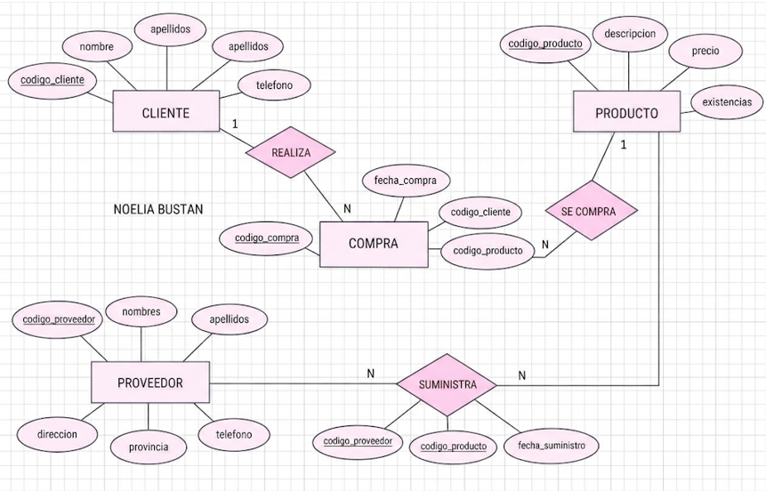

</details>

<details>
<summary><b>📊 Tablas</b></summary>

<br>

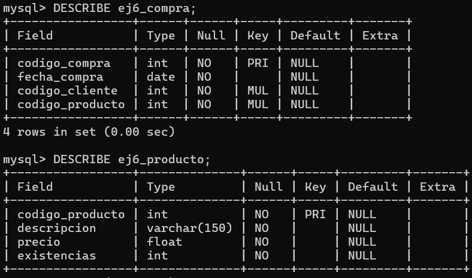

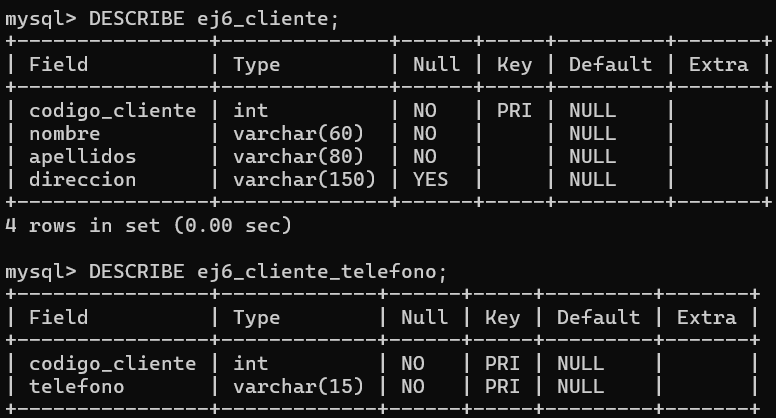

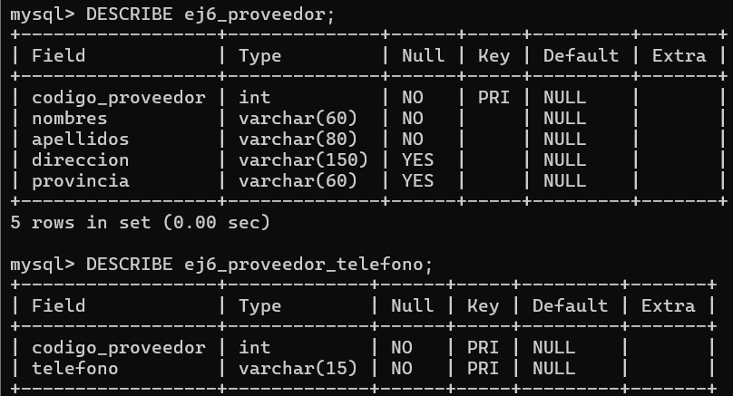

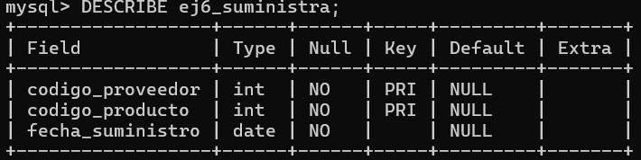

</details>

<details>
<summary><b>💻 Código SQL</b></summary>

<br>


```sql
USE ejercicios_BD;

CREATE TABLE ej6_hospital (
    codigo    INT PRIMARY KEY,
    nombre    VARCHAR(50) NOT NULL,
    direccion VARCHAR(100),
    telefono  VARCHAR(15),
    num_camas INT NOT NULL
);

CREATE TABLE ej6_sala (
    codigo_sala INT NOT NULL,
    codigo_hosp INT NOT NULL,
    nombre      VARCHAR(50) NOT NULL,
    num_camas   INT NOT NULL,
    PRIMARY KEY (codigo_sala, codigo_hosp),
    FOREIGN KEY (codigo_hosp) REFERENCES ej6_hospital(codigo)
);

CREATE TABLE ej6_doctor (
    dni         VARCHAR(10) PRIMARY KEY,
    nombre      VARCHAR(30) NOT NULL,
    apellidos   VARCHAR(40) NOT NULL,
    especialida VARCHAR(40) NOT NULL,
    codigo_hosp INT NOT NULL,
    FOREIGN KEY (codigo_hosp) REFERENCES ej6_hospital(codigo)
);

CREATE TABLE ej6_paciente (
    inscripcion INT PRIMARY KEY,
    nombre      VARCHAR(30) NOT NULL,
    apellidos   VARCHAR(40) NOT NULL,
    direccion   VARCHAR(100),
    fecha_nac   DATE NOT NULL,
    sexo        VARCHAR(10) NOT NULL
);

CREATE TABLE ej6_ingreso (
    num_ingreso INT PRIMARY KEY,
    numero_cama INT NOT NULL,
    codigo_sala INT NOT NULL,
    codigo_hosp INT NOT NULL,
    inscripcion INT NOT NULL,
    FOREIGN KEY (codigo_sala, codigo_hosp) REFERENCES ej6_sala(codigo_sala, codigo_hosp),
    FOREIGN KEY (inscripcion)              REFERENCES ej6_paciente(inscripcion)
);
```


</details>

---

## Ejercicio 7: Discos Musicales

**Descripción**

Una tienda vende discos de diferentes géneros musicales y cantantes.

- Cada género musical tiene un identificador.
- Cada disco tiene título, género musical, precio y cantante.
- De cada cantante se registra su nombre y país.
- Todo disco pertenece a un cantante y un cantante puede tener muchos discos.
- Cada canción tiene un identificador y un título.
- Un disco tiene muchas canciones y una canción puede estar en varios discos.
- Se debe registrar la posición de cada canción dentro de un disco.

<details>
<summary><b>📐 Diagrama Entidad-Relación</b></summary>

<br>


</details>

<details>
<summary><b>📊 Tablas</b></summary>

<br>

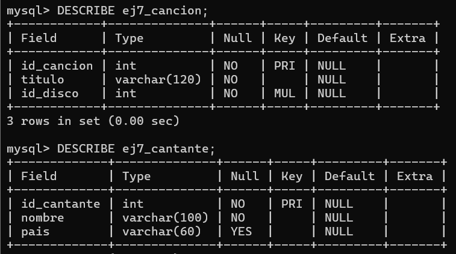

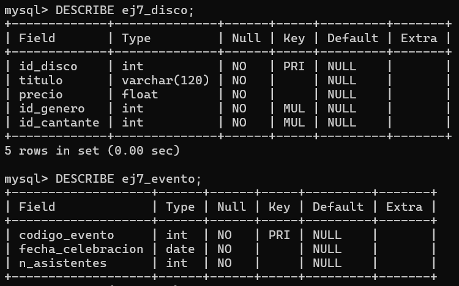

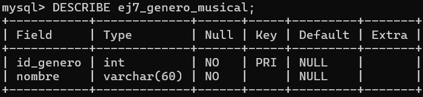

</details>

<details>
<summary><b>💻 Código SQL</b></summary>

<br>


```sql
USE ejercicios_BD;

CREATE TABLE ej7_comisaria (
    codigo    INT PRIMARY KEY,
    direccion VARCHAR(100) NOT NULL,
    telefono  VARCHAR(15)
);

CREATE TABLE ej7_policia (
    dni         VARCHAR(10) PRIMARY KEY,
    nombre      VARCHAR(30) NOT NULL,
    apellidos   VARCHAR(40) NOT NULL,
    fecha_asens DATE,
    cargo       VARCHAR(30) NOT NULL,
    codigo_com  INT NOT NULL,
    FOREIGN KEY (codigo_com) REFERENCES ej7_comisaria(codigo)
);

CREATE TABLE ej7_sindicato (
    codigo INT PRIMARY KEY,
    nombre VARCHAR(50) NOT NULL
);

CREATE TABLE ej7_afiliado (
    dni        VARCHAR(10) NOT NULL,
    codigo_sin INT NOT NULL,
    cuota      DECIMAL(8,2) NOT NULL,
    PRIMARY KEY (dni, codigo_sin),
    FOREIGN KEY (dni)        REFERENCES ej7_policia(dni),
    FOREIGN KEY (codigo_sin) REFERENCES ej7_sindicato(codigo)
);

CREATE TABLE ej7_delito (
    codigo      INT PRIMARY KEY,
    descripcion VARCHAR(150) NOT NULL
);

CREATE TABLE ej7_detenido (
    dni         VARCHAR(10) PRIMARY KEY,
    nombre      VARCHAR(30) NOT NULL,
    apellidos   VARCHAR(40) NOT NULL,
    direccion   VARCHAR(100),
    señas       VARCHAR(100)
);

CREATE TABLE ej7_comete (
    dni_detenido VARCHAR(10) NOT NULL,
    codigo_delito INT NOT NULL,
    PRIMARY KEY (dni_detenido, codigo_delito),
    FOREIGN KEY (dni_detenido)  REFERENCES ej7_detenido(dni),
    FOREIGN KEY (codigo_delito) REFERENCES ej7_delito(codigo)
);

CREATE TABLE ej7_participa (
    dni_policia  VARCHAR(10) NOT NULL,
    dni_detenido VARCHAR(10) NOT NULL,
    PRIMARY KEY (dni_policia, dni_detenido),
    FOREIGN KEY (dni_policia)  REFERENCES ej7_policia(dni),
    FOREIGN KEY (dni_detenido) REFERENCES ej7_detenido(dni)
);
```


</details>

---

## Ejercicio 8: Camiones

**Descripción**

Se desea informatizar la gestión de una empresa de transporte que reparte paquetes por toda España.

- **Camioneros:** Cédula, nombre, teléfono, dirección, salario y población donde viven. Un camionero distribuye muchos paquetes.
- **Paquetes:** Código, descripción, destinatario y dirección. Cada paquete es distribuido por un único camionero.
- **Provincias:** Código y nombre. Cada paquete llega a una provincia y una provincia puede recibir varios paquetes.
- **Camiones:** Matrícula, modelo, tipo y potencia. Un camionero puede conducir diferentes camiones en fechas distintas y un camión puede ser conducido por varios camioneros.

<details>
<summary><b>📐 Diagrama Entidad-Relación</b></summary>

<br>

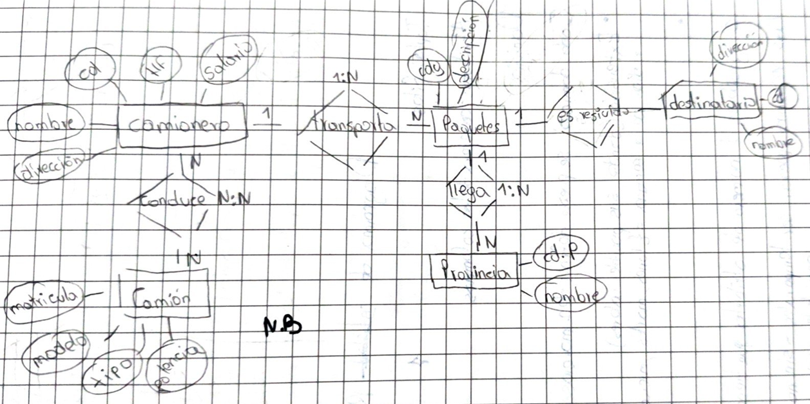

</details>

<details>
<summary><b>📊 Tablas</b></summary>

<br>

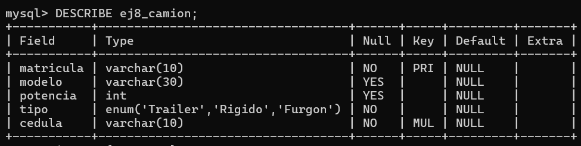

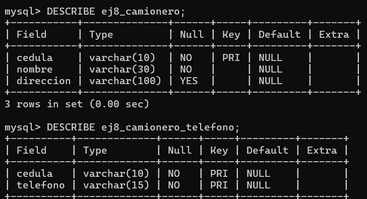

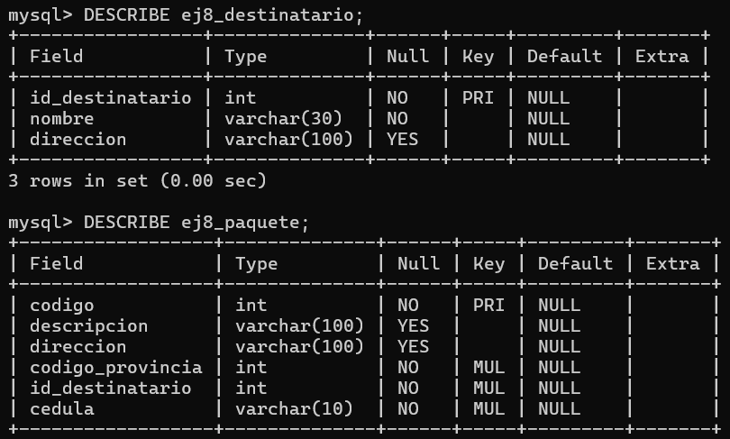

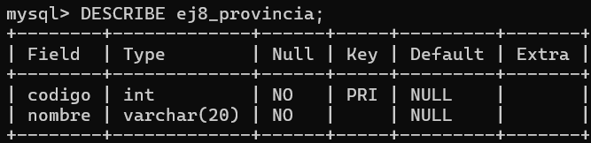

</details>

<details>
<summary><b>💻 Código SQL</b></summary>

<br>


```sql
USE ejercicios_BD;

CREATE TABLE ej8_provincia (
    codigo INT PRIMARY KEY,
    nombre VARCHAR(30) NOT NULL
);

CREATE TABLE ej8_destinatario (
    id_destinatario INT PRIMARY KEY,
    nombre          VARCHAR(30) NOT NULL,
    direccion       VARCHAR(100)
);

CREATE TABLE ej8_camionero (
    cedula    VARCHAR(10) PRIMARY KEY,
    nombre    VARCHAR(30) NOT NULL,
    direccion VARCHAR(100)
);

CREATE TABLE ej8_camionero_telefono (
    cedula   VARCHAR(10) NOT NULL,
    telefono VARCHAR(15) NOT NULL,
    PRIMARY KEY (cedula, telefono),
    FOREIGN KEY (cedula) REFERENCES ej8_camionero(cedula)
);

CREATE TABLE ej8_paquete (
    codigo            INT PRIMARY KEY,
    descripcion       VARCHAR(100),
    direccion         VARCHAR(100),
    codigo_provincia  INT NOT NULL,
    id_destinatario   INT NOT NULL,
    cedula            VARCHAR(10) NOT NULL,
    FOREIGN KEY (codigo_provincia) REFERENCES ej8_provincia(codigo),
    FOREIGN KEY (id_destinatario)  REFERENCES ej8_destinatario(id_destinatario),
    FOREIGN KEY (cedula)           REFERENCES ej8_camionero(cedula)
);

CREATE TABLE ej8_camion (
    matricula VARCHAR(10) PRIMARY KEY,
    modelo    VARCHAR(30),
    potencia  INT,
    tipo      ENUM('Trailer', 'Rigido', 'Furgon') NOT NULL,
    cedula    VARCHAR(10) NOT NULL,
    FOREIGN KEY (cedula) REFERENCES ej8_camionero(cedula)
);
```


</details>

---

## Ejercicio 9: Veterinaria

**Descripción**

Se desea diseñar una base de datos para gestionar una clínica veterinaria.

- **Propietario:** Cédula, apellidos, nombres, dirección y teléfonos. Un propietario puede llevar una o varias mascotas.
- **Mascota:** Identificador, nombre, fecha de nacimiento y tipo. Cada mascota pertenece a un único propietario.
- **Personal:** Código, cédula y nombre. Se distingue entre veterinarios, auxiliares y otros tipos de personal.
- **Veterinarios:** Fecha de alta y especialidad.
- **Auxiliares:** Base de cotización.
- **Consultas:** Una mascota puede pasar varias consultas con distintos veterinarios en diferentes fechas. Cada consulta registra un diagnóstico.
- **Familiar de contacto:** Cédula, nombre y teléfono. Cada propietario tiene un familiar para emergencias. Si el propietario se da de alta en la clínica veterinaria, el familiar deja de interesar. El familiar es contacto de un solo propietario.

<details>
<summary><b>📐 Diagrama Entidad-Relación</b></summary>

<br>

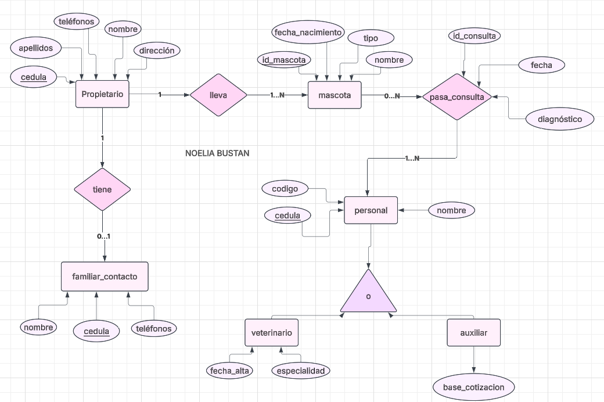

</details>

<details>
<summary><b>📊 Tablas</b></summary>

<br>

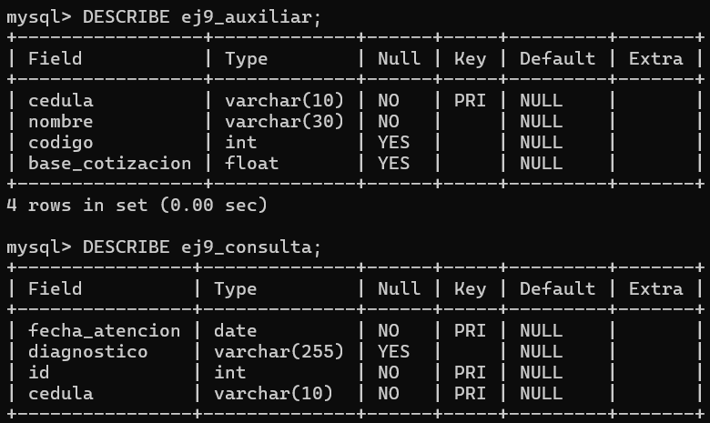

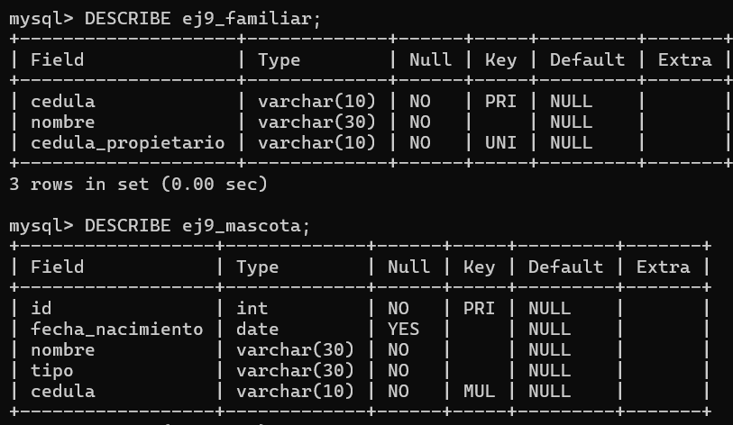

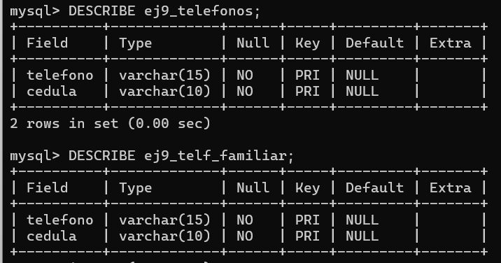

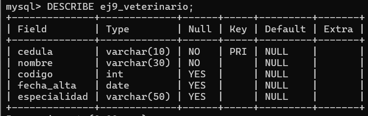

</details>

<details>
<summary><b>💻 Código SQL</b></summary>

<br>


```sql
USE ejercicios_BD;

CREATE TABLE ej9_propietario (
    cedula    VARCHAR(10) PRIMARY KEY,
    nombre    VARCHAR(30) NOT NULL,
    apellidos VARCHAR(40) NOT NULL,
    direccion VARCHAR(100)
);

CREATE TABLE ej9_telefonos (
    telefono VARCHAR(15) NOT NULL,
    cedula   VARCHAR(10) NOT NULL,
    PRIMARY KEY (telefono, cedula),
    FOREIGN KEY (cedula) REFERENCES ej9_propietario(cedula)
);

CREATE TABLE ej9_familiar (
    cedula             VARCHAR(10) PRIMARY KEY,
    nombre             VARCHAR(30) NOT NULL,
    cedula_propietario VARCHAR(10) NOT NULL UNIQUE,
    FOREIGN KEY (cedula_propietario) REFERENCES ej9_propietario(cedula)
);

CREATE TABLE ej9_telf_familiar (
    telefono VARCHAR(15) NOT NULL,
    cedula   VARCHAR(10) NOT NULL,
    PRIMARY KEY (telefono, cedula),
    FOREIGN KEY (cedula) REFERENCES ej9_familiar(cedula)
);

CREATE TABLE ej9_mascota (
    id               INT PRIMARY KEY,
    fecha_nacimiento DATE,
    nombre           VARCHAR(30) NOT NULL,
    tipo             VARCHAR(30) NOT NULL,
    cedula           VARCHAR(10) NOT NULL,
    FOREIGN KEY (cedula) REFERENCES ej9_propietario(cedula)
);

CREATE TABLE ej9_personal (
    cedula VARCHAR(10) PRIMARY KEY,
    nombre VARCHAR(30) NOT NULL,
    codigo INT UNIQUE
);

CREATE TABLE ej9_veterinario (
    cedula       VARCHAR(10) PRIMARY KEY,
    nombre       VARCHAR(30) NOT NULL,
    codigo       INT,
    fecha_alta   DATE,
    especialidad VARCHAR(50),
    FOREIGN KEY (cedula) REFERENCES ej9_personal(cedula)
);

CREATE TABLE ej9_auxiliar (
    cedula          VARCHAR(10) PRIMARY KEY,
    nombre          VARCHAR(30) NOT NULL,
    codigo          INT,
    base_cotizacion FLOAT,
    FOREIGN KEY (cedula) REFERENCES ej9_personal(cedula)
);

CREATE TABLE ej9_consulta (
    fecha_atencion DATE NOT NULL,
    diagnostico    VARCHAR(255),
    id             INT NOT NULL,
    cedula         VARCHAR(10) NOT NULL,
    PRIMARY KEY (fecha_atencion, id, cedula),
    FOREIGN KEY (id)     REFERENCES ej9_mascota(id),
    FOREIGN KEY (cedula) REFERENCES ej9_veterinario(cedula)
);
```


</details>

---

<div align="center">

**FIN DEL PORTAFOLIO**

*9 ejercicios de modelado de bases de datos*

</div>

