# 🌸 Colección de Diagramas Entidad-Relación (E-R) ✨

¡Bienvenid@ a mi repositorio de **Bases de Datos**! 💖 Aquí encontrarás una colección organizada de diseños conceptuales y diagramas Entidad-Relación (E-R) desarrollados para diversos escenarios académicos y prácticos[cite: 1].

---

## 📌 Datos de la Estudiante

| Campo | Detalles |
| :--- | :--- |
| **Estudiante** | Noelia Bustan |
| **Institución** | Universidad Nacional de Loja |
| **Facultad** | Energía, las Industrias y los Recursos Naturales No Renovables |
| **Carrera** | Computación |
| **Materia** | Base de Datos |
| **Docente** | Ing. René Guamán |
| **Periodo Académico** | 2026 - 2027 |

---

# 📚 PORTAFOLIO DE BASES DE DATOS

### Colección de Diagramas Entidad-Relación

**9 ejercicios prácticos de modelado de bases de datos**

---

*Diseño conceptual · Diagramas E-R · Modelo relacional · SQL*

## 📑 Índice de ejercicios

| N.º | Ejercicio | Categoría |
|:---:|:---|:---|
| 01 | [Sistema de Biblioteca](#ejercicio-1-sistema-de-biblioteca) | Ejemplo guiado |
| 02 | [Pedidos de Restaurante](#ejercicio-2-pedidos-de-restaurante) | Ejemplo guiado |
| 03 | [Clínica Médica](#ejercicio-3-clínica-médica) | Ejemplo guiado |
| 04 | [Sistema de Aerolínea](#ejercicio-4-sistema-de-aerolínea) | Ejemplo guiado |
| 05 | [Empresa Discográfica](#ejercicio-5-empresa-discográfica) | Ejercicio propuesto |
| 06 | [Tienda Informática](#ejercicio-6-tienda-informática) | Ejercicio propuesto |
| 07 | [Discos Musicales](#ejercicio-7-discos-musicales) | Ejercicio propuesto |
| 08 | [Camiones](#ejercicio-8-camiones) | Ejercicio propuesto |
| 09 | [Veterinaria](#ejercicio-9-veterinaria) | Ejercicio propuesto |

---

# 01 · EJEMPLOS GUIADOS

## Ejercicio 1: Sistema de Biblioteca

**Descripción**

Una biblioteca registra libros y autores. Un libro puede tener varios autores y un autor varios libros. Los socios toman libros prestados; de cada préstamo interesan la fecha de retiro y la de devolución.

<b>📐 Diagrama Entidad-Relación</b>

 

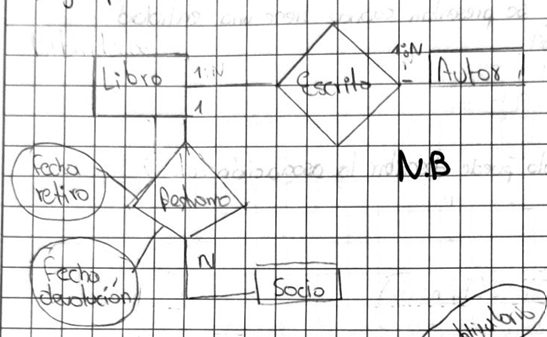

<b>📊 Tablas</b>

 

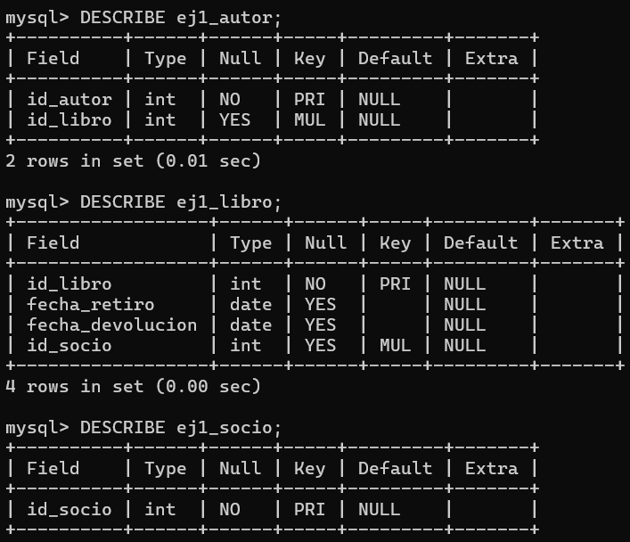

<b>💻 Código SQL</b>

 

*Código SQL pendiente de incorporar.*

---

## Ejercicio 2: Pedidos de Restaurante

**Descripción**

Los clientes realizan pedidos que contienen varios platos con distinta cantidad. Los platos se agrupan en categorías. Cada pedido lo atiende un único mesero. El precio del plato debe registrarse tal como estaba al momento del pedido, aunque luego cambie.

<b>📐 Diagrama Entidad-Relación</b>

 

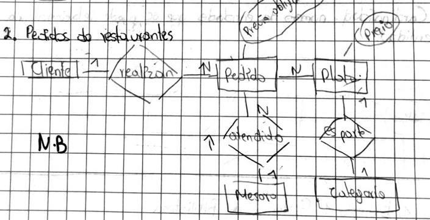

<b>📊 Tablas</b>

 

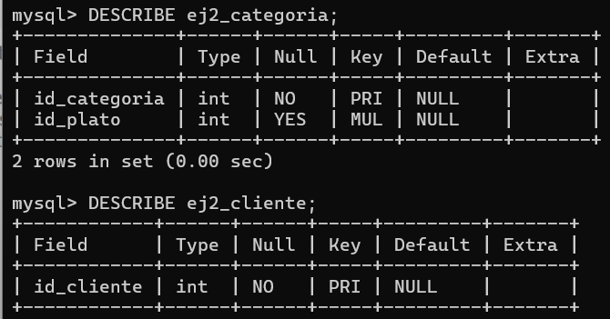

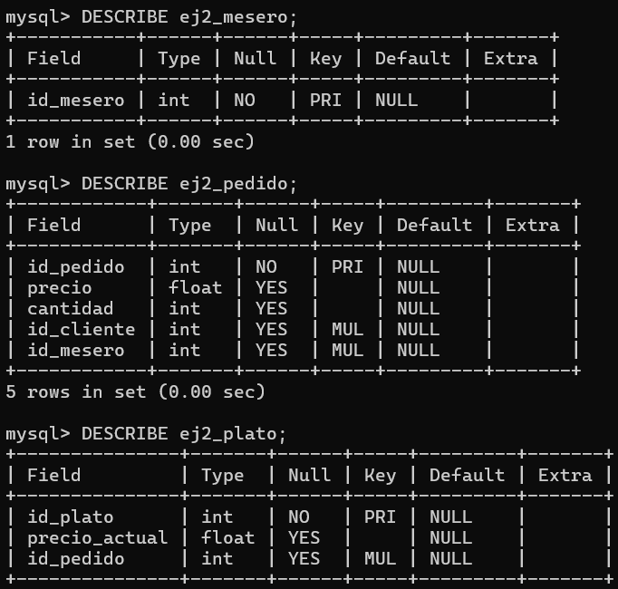

<b>💻 Código SQL</b>

 

*Código SQL pendiente de incorporar.*

---

## Ejercicio 3: Clínica Médica

**Descripción**

Los pacientes solicitan citas; cada cita la atiende un médico a un paciente en fecha, hora y consultorio. De algunas citas se genera una receta que incluye medicamentos con dosis y duración. Cada médico pertenece a una especialidad.

<b>📐 Diagrama Entidad-Relación</b>

 

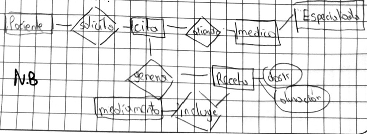

<b>📊 Tablas</b>

 

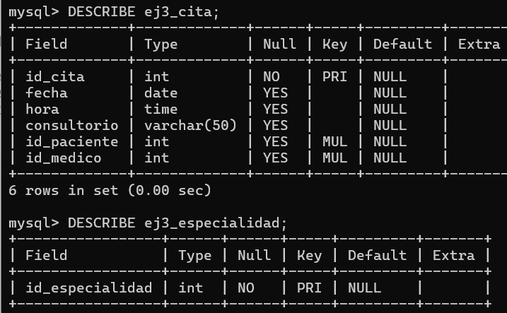

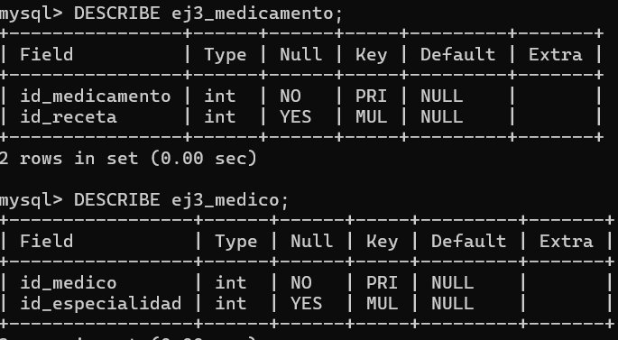

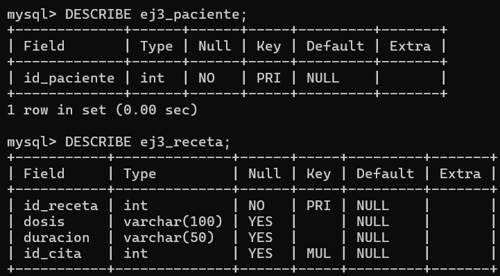

<b>💻 Código SQL</b>

 

*Código SQL pendiente de incorporar.*

---

## Ejercicio 4: Sistema de Aerolínea

**Descripción**

Una aerolínea opera vuelos (cada uno con número, fecha, origen y destino), cada vuelo lo realiza un avión. Los pasajeros realizan reservas para un vuelo específico, indicando asiento y tarifa pagada en el momento de la reserva.

<b>📐 Diagrama Entidad-Relación</b>

 

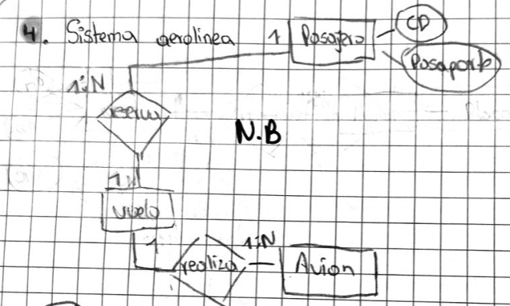

<b>📊 Tablas</b>

 

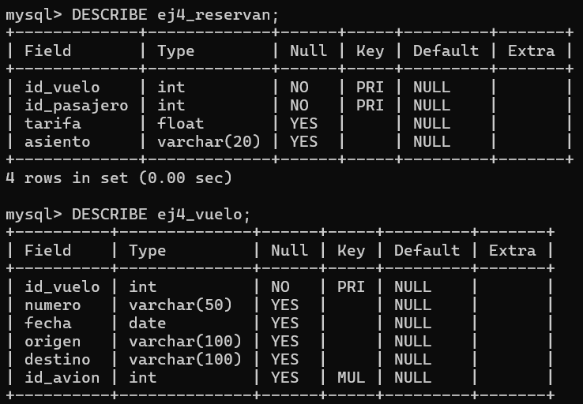

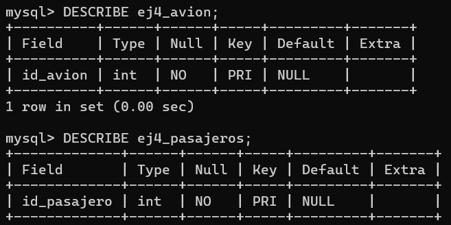

<b>💻 Código SQL</b>

 

*Código SQL pendiente de incorporar.*

---

# 02 · EJERCICIOS PROPUESTOS

## Ejercicio 5: Empresa Discográfica

**Descripción**

Una empresa discográfica necesita modelar los datos sobre sus diferentes recursos según las siguientes características:

- **Manager:** De cada mánager se almacena un identificador y su nombre. Un manager representa a una serie de artistas.
- **Artista:** Un artista es representado por un manager. Se almacena su nombre completo y su NIF.
- **Evento de promoción:** Los artistas participan en eventos de promoción para dar a conocer sus trabajos. En un evento pueden participar varios artistas. Se almacena un identificador único, la fecha de celebración y el número de asistentes.

<b>📐 Diagrama Entidad-Relación</b>

 

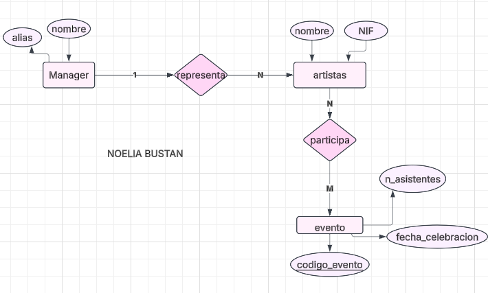

<b>📊 Tablas</b>

 

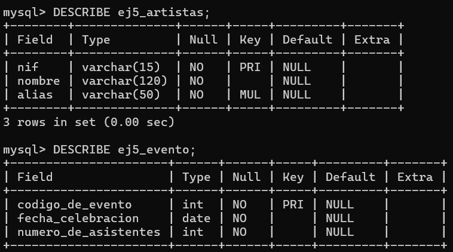

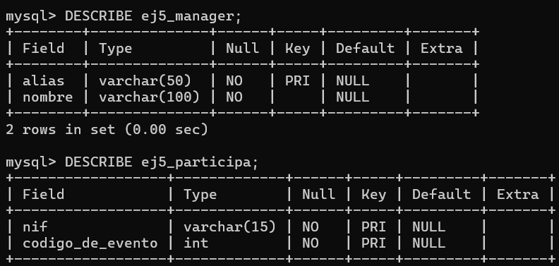

<b>💻 Código SQL</b>

 

*Código SQL pendiente de incorporar.*

---

## Ejercicio 6: Tienda Informática

**Descripción**

Se desea crear una aplicación para la gestión de una tienda informática. La tienda dispone de productos que se venden a los clientes.

- **Productos:** Código, descripción, precio y número de existencias.
- **Clientes:** Código, nombre, apellidos, dirección y número telefónico.
- **Compras:** Un cliente puede comprar varios productos y un producto puede ser comprado por varios clientes. Cada compra registra su fecha.
- **Proveedores:** Un producto puede ser suministrado por varios proveedores. Se almacena código, nombres, apellidos, dirección, provincia y teléfono.

<b>📐 Diagrama Entidad-Relación</b>

 

<b>📊 Tablas</b>

 

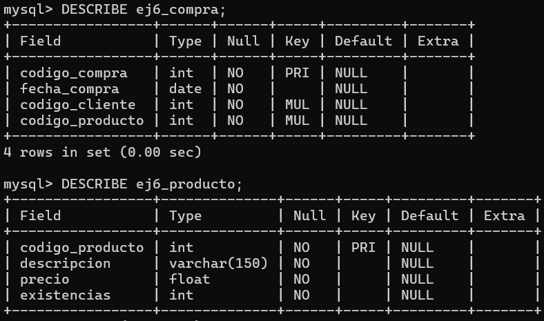

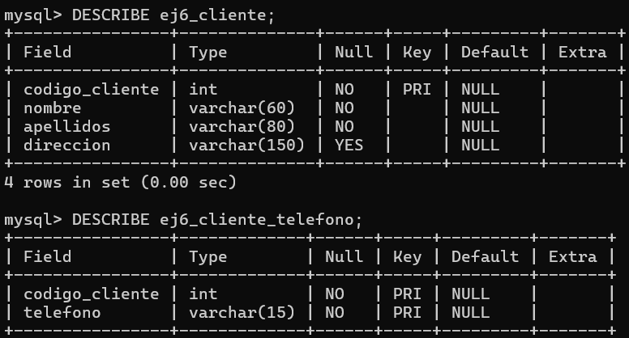

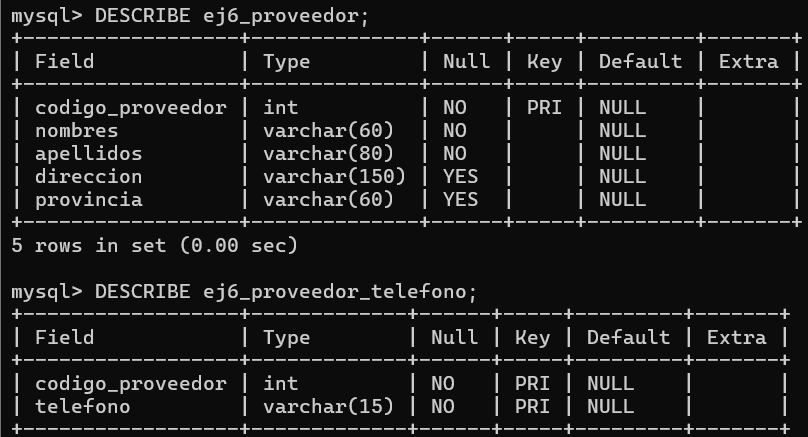

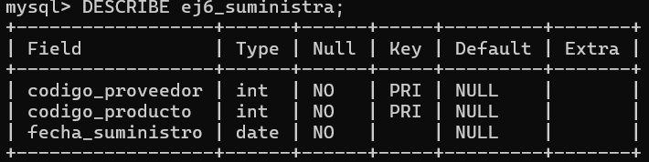

<b>💻 Código SQL</b>

 

*Código SQL pendiente de incorporar.*

---

## Ejercicio 7: Discos Musicales

**Descripción**

Una tienda vende discos de diferentes géneros musicales y cantantes.

- Cada género musical tiene un identificador.
- Cada disco tiene título, género musical, precio y cantante.
- De cada cantante se registra su nombre y país.
- Todo disco pertenece a un cantante y un cantante puede tener muchos discos.
- Cada canción tiene un identificador y un título.
- Un disco tiene muchas canciones y una canción puede estar en varios discos.
- Se debe registrar la posición de cada canción dentro de un disco.

<b>📐 Diagrama Entidad-Relación</b>

 

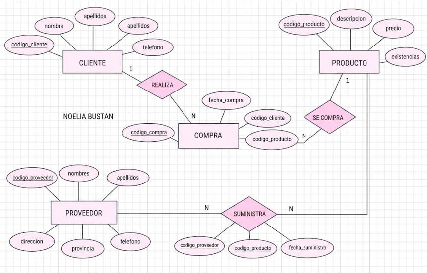

<b>📊 Tablas</b>

 

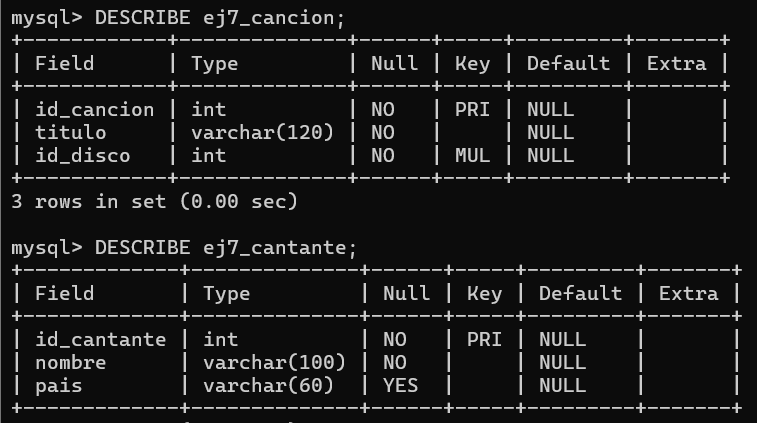

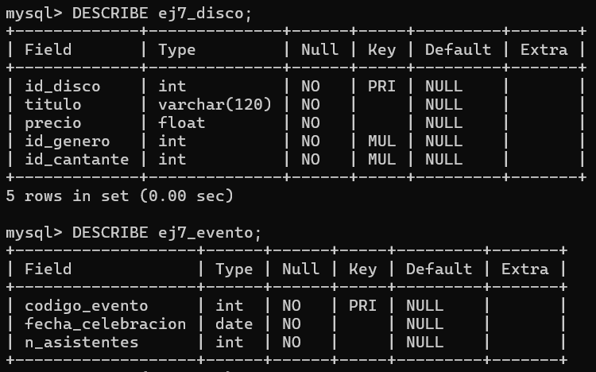

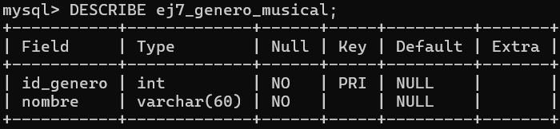

<b>💻 Código SQL</b>

 

*Código SQL pendiente de incorporar.*

---

## Ejercicio 8: Camiones

**Descripción**

Se desea informatizar la gestión de una empresa de transporte que reparte paquetes por toda España.

- **Camioneros:** Cédula, nombre, teléfono, dirección, salario y población donde viven. Un camionero distribuye muchos paquetes.
- **Paquetes:** Código, descripción, destinatario y dirección. Cada paquete es distribuido por un único camionero.
- **Provincias:** Código y nombre. Cada paquete llega a una provincia y una provincia puede recibir varios paquetes.
- **Camiones:** Matrícula, modelo, tipo y potencia. Un camionero puede conducir diferentes camiones en fechas distintas y un camión puede ser conducido por varios camioneros.

<b>📐 Diagrama Entidad-Relación</b>

 

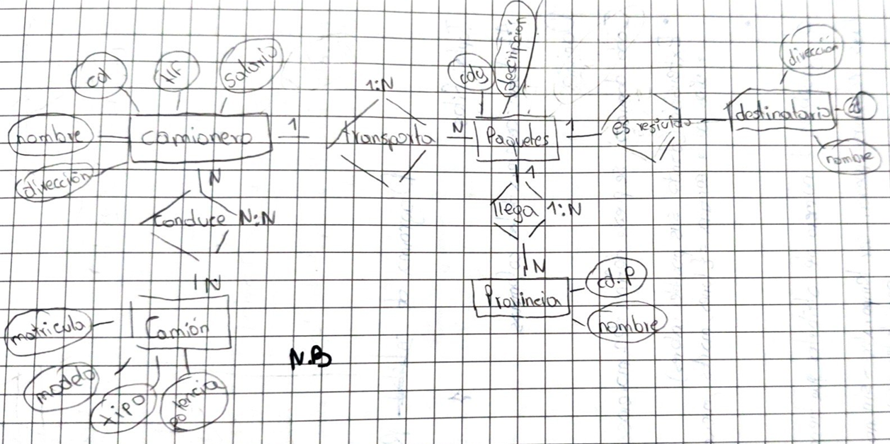

<b>📊 Tablas</b>

 

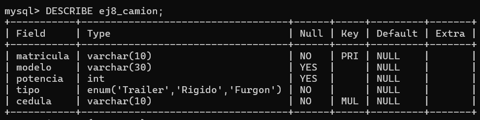

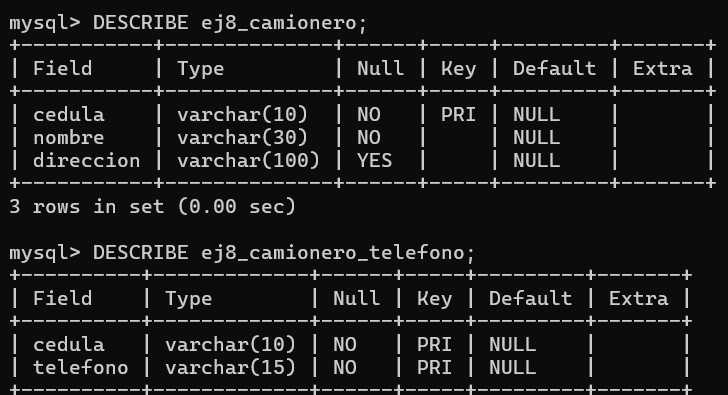

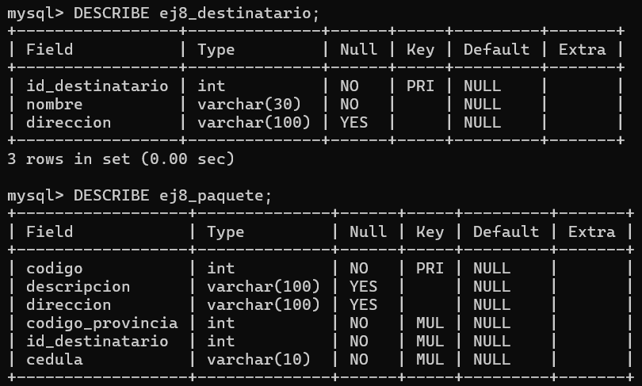

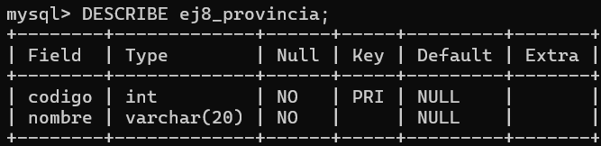

<b>💻 Código SQL</b>

 

*Código SQL pendiente de incorporar.*

---

## Ejercicio 9: Veterinaria

**Descripción**

Se desea diseñar una base de datos para gestionar una clínica veterinaria.

- **Propietario:** Cédula, apellidos, nombres, dirección y teléfonos. Un propietario puede llevar una o varias mascotas.
- **Mascota:** Identificador, nombre, fecha de nacimiento y tipo. Cada mascota pertenece a un único propietario.
- **Personal:** Código, cédula y nombre. Se distingue entre veterinarios, auxiliares y otros tipos de personal.
- **Veterinarios:** Fecha de alta y especialidad.
- **Auxiliares:** Base de cotización.
- **Consultas:** Una mascota puede pasar varias consultas con distintos veterinarios en diferentes fechas. Cada consulta registra un diagnóstico.
- **Familiar de contacto:** Cédula, nombre y teléfono. Cada propietario tiene un familiar para emergencias. Si el propietario se da de alta en la clínica veterinaria, el familiar deja de interesar. El familiar es contacto de un solo propietario.

<b>📐 Diagrama Entidad-Relación</b>

 

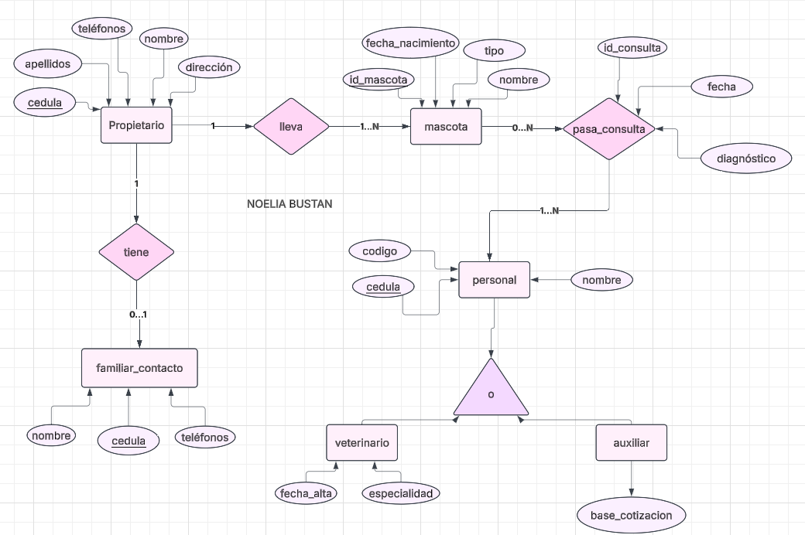

<b>📊 Tablas</b>

 

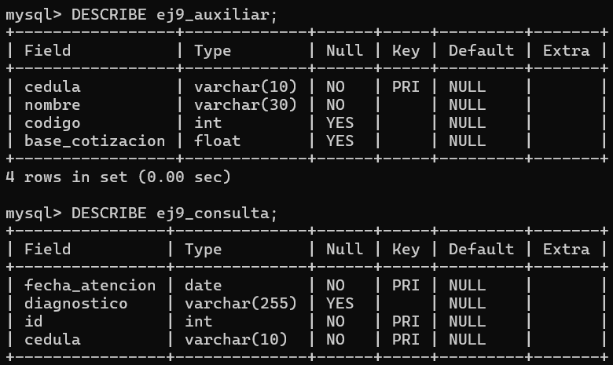

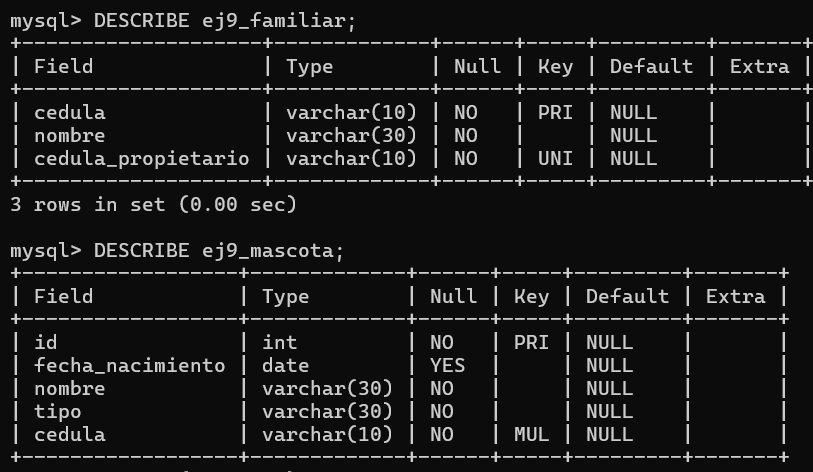

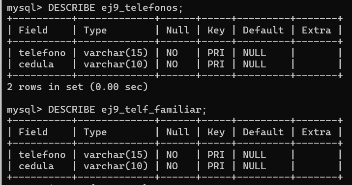

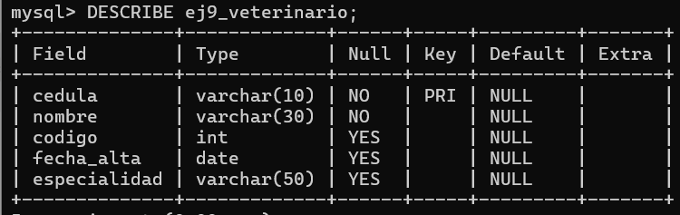

<b>💻 Código SQL</b>

 

*Código SQL pendiente de incorporar.*

---

**FIN DEL PORTAFOLIO**

*9 ejercicios de modelado de bases de datos*

